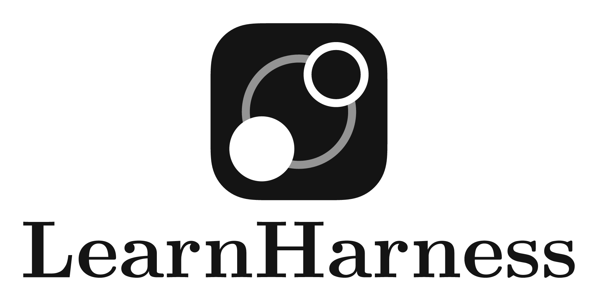
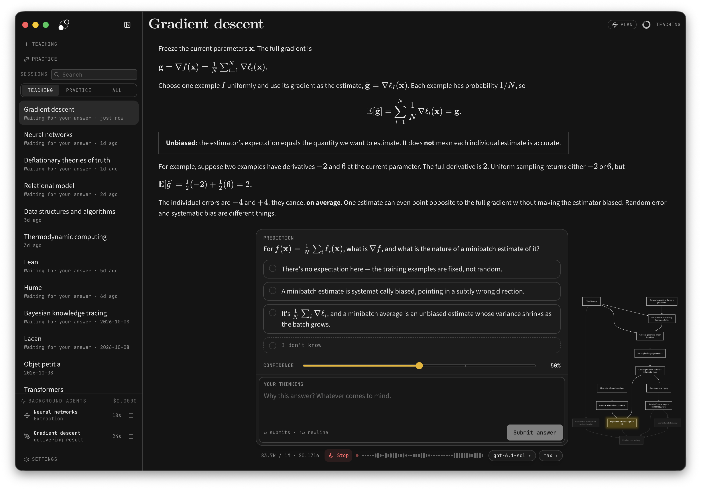
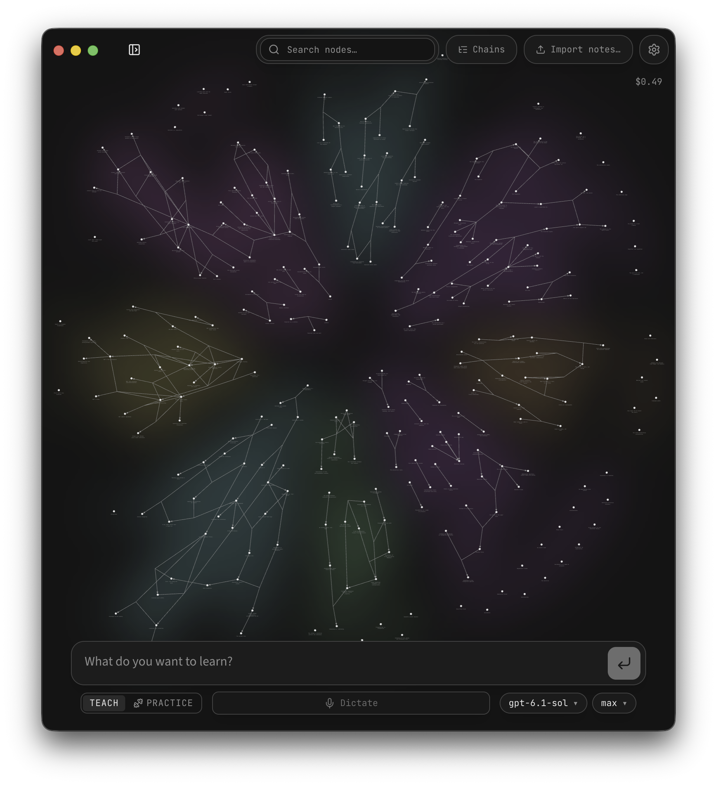

<p align="center">
  <picture>
    <source media="(prefers-color-scheme: dark)" srcset="docs/assets/lh_banner_dark.png">
    <source media="(prefers-color-scheme: light)" srcset="docs/assets/lh_banner_light.png">
    
  </picture>
</p>

<p align="center"><strong>An agent harness for learning.</strong></p>

<p align="center">
  <a href="https://learnharness.ai">Download</a> ·
  <a href="#how-it-works">How it works</a> ·
  <a href="docs/development.md">Documentation</a> ·
  <a href="https://github.com/amosblomqvist/learnharness/issues">Issues</a> ·
  <a href="https://discord.gg/5tCHHQEB2e">Discord</a>
</p>

LearnHarness uses AI agents to plan and teach lessons from your current understanding to your goal. It builds a detailed picture of what you understand and how you reason. That picture is updated as you learn.

Instead of just giving you an explanation, it uses your answers and thinking to decide what you need next. Teaching builds understanding one reasoning step at a time. Practice makes it usable. A persistent knowledge graph carries it across sessions.



## How it works

1. **Measure.** Before teaching, the agent finds where your understanding ends on each part the lesson depends on. Your answers, confidence, and thinking show it where to start.
2. **Plan.** It works out a dependency map from that starting point to your goal. You can see the plan, and the lesson adapts when your understanding turns out different.
3. **Teach.** Each step builds on something you already understand. You predict, get an explanation, and check your understanding. Confusions are repaired before anything is built on them. The aim is for the goal to feel obviously true, not merely familiar.
4. **Practice.** Separate sessions pose varied problems that require the right knowledge to come to mind without being named first. Problems and hints adapt to your reasoning.

**Think out loud.** The thinking fields let you explain your reasoning, uncertainties, and reactions in your own words. This is how the agent gets a detailed picture rather than just a record of right and wrong answers.

The agent can also research questions in the background, create visual explanations, and build interactive demonstrations.

## Knowledge that carries forward

What you are taught accumulates as propositions and reasoning chains: individual claims and the premises that lead to them. The graph shows this structure, with links back to the source sessions. You can also import notes.

Future teaching sessions can read the graph instead of starting from scratch. Practice sessions can draw their material from it. It stores the ideas and their connections, not ratings of your ability.



## Download and get started

**[Download from learnharness.ai](https://learnharness.ai)** · [GitHub Releases](https://github.com/amosblomqvist/learnharness/releases)

- **macOS (Apple Silicon):** signed and notarized DMG. Drag the app to Applications.

Add your provider API key and choose your models, then start a session with what you want to understand. LearnHarness supports 30+ provider options, including OpenAI, Anthropic, Google, DeepSeek, and OpenRouter. With a Claude subscription model, the research assistant searches the web through Claude Code. With other providers, it reads pages it can name without searching.

## Your keys, your data

- **Your keys and models.** No LearnHarness subscription or markup. You pay your providers for usage; a live cost meter shows model costs.
- **Local storage.** Your chats, graph, settings, and API keys live on your machine. Learning records are plain files you can inspect.
- **External services.** Models run through your configured providers. Model requests send the context needed for the task; web research also contacts external services. Local storage does not mean offline processing.
- **Inspectable behavior.** System prompts are visible and editable. The app is open source under the AGPL-3.0 license.

## Development and support

```bash
npm install
npm run dev        # http://localhost:3000
npm test           # deterministic, no LLM, no network
```

### Open it from Spotlight

`scripts/launcher/install.sh` builds `~/Applications/Chiron.app` (run it once; the name comes from `electron/product.cjs`). When main renames the app, the launch after the one that pulled the rename rebuilds the .app under the new name, opens it and removes the old copy. The folders below keep the app's first name, LearnHarness, so a rename moves no data. Opening it runs the app in dev mode from the repository's main checkout:

- **Always on the latest main.** A checkout on `main` with no tracked changes runs `git fetch origin main` and `git merge --ff-only origin/main`, then `npm ci` if `package-lock.json` changed. Any other checkout opens as it is, with one notification saying why it wasn't updated.
- **Never frozen.** A window opens at once and says "Updating Chiron…" while it updates and reinstalls; the app's own window takes its place once the page is ready.
- **Live.** `next dev` runs on 127.0.0.1:4747 and the window reloads on every change to pages, server routes and the engine. A change to `electron/` needs a relaunch.
- **One instance.** Opening it again focuses the window. Quitting stops the server. Logs go to `~/Library/Logs/LearnHarness/`.
- **The same data** as `npm run desktop:dev`: `data/` in the checkout, the engine's courses, and `~/Library/Application Support/LearnHarness-dev`. The window's own preferences (localStorage: sidebar, last course, drafts) are kept per address, so they start fresh at 127.0.0.1:4747.
- **Its API is closed to other programs**, as in the packaged app: only the window holds the per-launch key.

For a test run, `LH_CHECKOUT`, `LH_LAUNCH_PORT`, `LH_LAUNCH_LOGS` and `LH_DATA_DIR` override the checkout, port, logs and data, and `LH_USER_DATA_DIR` the userData folder (the app adds `-dev`): `open -a Chiron --env NAME=value`.

See the [development guide](docs/development.md), [architecture](docs/architecture.md), and [desktop build guide](docs/desktop-release.md).

Questions, bug reports, and feature requests: [GitHub Issues](https://github.com/amosblomqvist/learnharness/issues).

## License

[AGPL-3.0](LICENSE)

The app is free and open forever. If we ever charge for anything, it will be for convenience — managed keys, hosting — never for features you can run locally.
